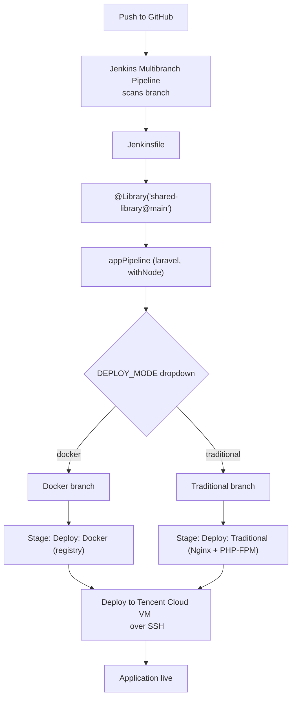

# KosKu — Cari Kos Mahasiswa Perantau

Aplikasi web pencarian kos untuk mahasiswa perantau. Backend REST API (Laravel) +
Single Page Application (Vue 3), mencakup pencarian dengan filter lokasi/harga/fasilitas,
peta interaktif, tautan WhatsApp & Google Maps, ulasan & favorit, dashboard pemilik, serta
moderasi admin.

## Tumpukan Teknologi

- **Backend**: Laravel 12, Laravel Sanctum (SPA cookie auth), PostgreSQL
- **Frontend**: Vue 3, Vue Router, Pinia, Tailwind CSS v4, Leaflet, Vite
- **Testing**: PHPUnit (fitur API)

## Fitur

- Pencarian kos publik dengan filter tipe, rentang harga, fasilitas, ketersediaan, urutan
- Halaman detail kos dengan galeri foto, fasilitas, peta Leaflet, tautan WhatsApp & Google Maps
- Ulasan + rating (hanya ulasan terlihat yang dihitung), favorit
- Dashboard pemilik: CRUD kos, unggah/urutkan foto, update sisa kamar cepat
- Dashboard admin: verifikasi pemilik, moderasi kos, sembunyikan ulasan, kelola fasilitas & pengguna
- Aturan bisnis: kos tampil publik hanya jika `status=active` dan pemiliknya terverifikasi & aktif

## CI/CD

### Overview

Deployment is automated with a **Jenkins Multibranch Pipeline** driven by the
`Jenkinsfile` at the repository root. Application logic (build, test, Docker image
build/push) is provided by a **Jenkins Shared Library** loaded via
`@Library('shared-library@main')`. Container builds rely on **Docker** and the
compiled image is published to **Docker Hub**, while the actual release is pushed
to a **Tencent Cloud** VM (`<SERVER_IP>`) over SSH.

### Pipeline Architecture



The only stages declared directly in the `Jenkinsfile` are
`Deploy: Docker (registry)` and `Deploy: Traditional (Nginx + PHP-FPM)`; build/test
stages are created inside `appPipeline` by the shared library.

### Deployment Modes

The pipeline is parameterized by a `DEPLOY_MODE` dropdown with two choices:
`traditional` (default, first choice in the list) and `docker`.

| Aspect | `docker` | `traditional` |
| --- | --- | --- |
| How it deploys | Shared library builds and pushes a Docker image (with an additional `latest` tag) to Docker Hub. Jenkins copies `compose.prod.yml` to the server, then runs `docker compose pull`, `up -d --remove-orphans`, and `php artisan migrate --force` inside the `app` container. | Jenkins pipes `deploy/deploy.sh` over SSH. The script runs `git fetch`/`checkout`/`pull --ff-only`, `composer install --no-dev`, `npm ci` + `npm run build`, `php artisan migrate --force`, `config:cache`/`route:cache`, then reloads PHP-FPM. |
| Installed / run on server | Docker Engine + Compose plugin; PostgreSQL runs as the `db` container (`postgres:16-alpine`). The image bundles Nginx + PHP-FPM (`Dockerfile` stage 3). An `.env` file is required on the host. | Native Nginx (config `deploy/nginx-traditional.conf`), PHP-FPM (`php8.5-fpm`), Composer, Node.js/npm, PostgreSQL, and `git`. The source tree lives at `/var/www/kosku`. |
| Pros | Reproducible, immutable artifacts; build happens in CI, not on the server; rolling back means switching image tags; no host PHP/Node toolchain needed. | No image registry required; code is directly inspectable on the server; simple single-VM setup. |
| Cons | Requires Docker Hub credentials and a reachable registry; persistent state must live in volumes; image build/pull adds time. | Server must carry the full toolchain; build runs on the VM (slower, resource heavy); configuration drift and manual rollback via git. |
| When to use | Consistent, CI-built releases and parity between environments. | Simple single VM without a registry, or when you want to debug directly on the server. |

Both modes are kept on purpose: the same application can be shipped either as an
immutable container image or as a mutable, git-checked-out host, which makes the
trade-offs (build location, reproducibility, rollback, server dependencies) easy
to compare in practice — an explicit exercise in deployment approaches rather
than a single canned tutorial path.

### How to Run

1. Open the Multibranch job in Jenkins and select the branch to build (the
   pipeline scans branches automatically).
2. Click **Build with Parameters**.
3. Choose the **`DEPLOY_MODE`** value: `traditional` or `docker`.
4. Run the build and watch the stages, ending in either
   `Deploy: Docker (registry)` or `Deploy: Traditional (Nginx + PHP-FPM)`.

### Screenshots


*Jenkins "Build with Parameters" form showing the `DEPLOY_MODE` dropdown.*


*Successful pipeline run using the `docker` deployment mode.*


*Successful pipeline run using the `traditional` deployment mode.*

### Shared Library

The shared library is consumed as
[jenkins-shared-library](https://github.com/Fawwazfara/REPO_NAME_DI_SINI)
(loaded with `@Library('shared-library@main')`).

<!-- TODO: replace REPO_NAME_DI_SINI with the real shared-library repository name. -->

Based on its usage in the `Jenkinsfile`, the library exposes an `appPipeline`
step that accepts `type: 'laravel'`, an `agent` label, `laravel: [withNode: true]`
to build frontend assets, `docker: [imageName: ..., additionalTags: ['latest']]`
to build/push the image, and `skipDocker: true` to build without a container
image.

<!-- TODO: the internal stages created by appPipeline (checkout/install/test/build) are defined in the shared library, not in this repo; document them from the library source. -->
<!-- TODO: confirm the exact PHP-FPM version on the target VM (deploy.sh defaults to php8.5-fpm) and the branch deploy.sh should track (defaults to main). -->
<!-- TODO: add the three screenshots under docs/images/ referenced above. -->

## Menjalankan

### 1. Prasyarat
- PHP 8.3+ dengan ekstensi `pdo_pgsql`, `dom`, `zip`
- Composer, Node.js 20+, PostgreSQL

### 2. Instalasi
```bash
composer install
cp .env.example .env
php artisan key:generate
```

Sesuaikan kredensial database di `.env`:
```env
DB_CONNECTION=pgsql
DB_HOST=127.0.0.1
DB_PORT=5432
DB_DATABASE=kosku
DB_USERNAME=kosku
DB_PASSWORD=kosku

APP_LOCALE=id
FILESYSTEM_DISK=public
SESSION_DOMAIN=null
SANCTUM_STATEFUL_DOMAINS=localhost,localhost:8000,127.0.0.1,127.0.0.1:8000
```

### 3. Migrasi, seed, storage link
```bash
php artisan migrate --seed
php artisan storage:link
```

### 4. Aset frontend
```bash
npm install
npm run build      # produksi
# atau: npm run dev  (pengembangan)
```

### 5. Jalankan server
```bash
php artisan serve --host=0.0.0.0 --port=8000
```
Buka `http://localhost:8000`.

## Akun Demo

Kata sandi semua akun: `password`

| Peran              | Email                     |
| ------------------ | ------------------------- |
| Admin              | admin@kosku.test          |
| Pemilik terverifikasi | pemilik@kosku.test     |
| Pemilik belum verifikasi | pemilik.baru@kosku.test |
| Mahasiswa          | mahasiswa@test.com        |

## Pengujian

```bash
php artisan test
```
`phpunit.xml` menggunakan SQLite in-memory, jadi pastikan ekstensi `pdo_sqlite` tersedia.
Uji coba cepat API end-to-end: lihat skrip smoke test manual.

## Ringkasan API

Publik:
- `GET /api/kos` — daftar (filter: `q`, `type`, `price_min`, `price_max`, `facilities[]`, `available`, `sort`, `per_page`)
- `GET /api/kos/{slug}` — detail
- `GET /api/facilities`
- `POST /api/kos/{slug}/wa-click` — catat klik WhatsApp

Autentikasi (Sanctum SPA): `POST /api/register`, `POST /api/login`, `POST /api/logout`, `GET /api/user`
(Panggil `GET /sanctum/csrf-cookie` lebih dulu; frontend mengirim cookie + header `X-XSRF-TOKEN`.)

Mahasiswa: `POST /api/kos/{slug}/reviews`, `PUT/DELETE /api/reviews/{id}`,
`GET /api/favorites`, `POST/DELETE /api/kos/{slug}/favorite`

Pemilik: `GET /api/owner/dashboard`, resource `api/owner/kos`, `PUT /api/owner/kos/{kos}/stock`,
`POST /api/owner/kos/{kos}/photos`, dll.

Admin: `GET /api/admin/dashboard`, `POST /api/admin/owners/{user}/verify`,
`POST /api/admin/kos/{kos}/approve|reject|hide`, `POST /api/admin/reviews/{review}/hide|unhide`,
resource `api/admin/facilities`, `GET /api/admin/users`, `POST /api/admin/users/{user}/toggle-active`

## Struktur Penting

```
app/Http/Controllers/Api/   # Auth, Kos, Review, Favorite, Facility + Owner/* + Admin/*
app/Http/Requests/          # Validasi & otorisasi form
app/Http/Resources/         # Bentuk respons JSON
app/Models/                 # User, Kos, KosPhoto, Facility, Review
app/Policies/               # KosPolicy, ReviewPolicy, FacilityPolicy, UserPolicy
app/Support/helpers.php     # normalize_whatsapp, whatsapp_link, maps_link
database/seeders/           # Data demo + gambar contoh
resources/js/               # SPA Vue (router, stores, components, pages)
routes/api.php              # Semua rute API
```
